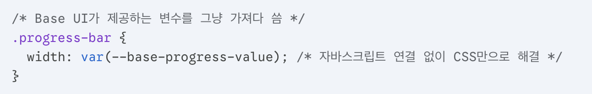

---

- BaseUI : RadixUI와 MUI(Material UI)팀이 손잡고 만든 headless UI 라이브러리.
  그러면 RadixUI와 어떤 점이 다를까?
- RadixUI의 asChild 속성 패턴의 간소화 : 보통 UI 라이브러리에서 버튼 컴포넌트를 가져다 쓰면, 라이브러리 마음대로 `<button>` 태그를 화면에 렌더링 하는데, 이는 태그 중첩을 일으킨다. 따라서 radix에서는 asChild 속성을 사용하여 내가 원하는 시멘틱 태그만 그대로 유지할 수 있어 기존 마크업 구조를 해치지 않는 DOM 구조의 무결성을 유지할 수 있다.
  BaseUI에서는 앞서 말한 asChild 개념을 더 발전시켰는데, 기존에 asChild 속성을 일일이 적어줘야했던 반면, BaseUI는 컴포넌트 자체를 다른 태그로 렌더링하는 방식(render prop 또는 직관적인 API)을 도입해서 개발자가 실수할 확률을 더 줄여준다.
- 기존 RadixUI는 스타일을 입힐 때 까다로운 구석이 있었음.
  - Headless의 양날의 검 : RadixUI는 디자인이 아예 없는 뼈대만 제공한다. 이게 장점이기도 하지만, 초보자나 빠른 개발이 필요한 사람에게는 ‘재앙’이다.
  - 상태에 따른 스타일링 : RadixUI는 컴포넌트가 open/close/checked 등을 클래스 명이 아니라 HTML 데이터 속성으로 관리한다. .active 같은 클래스 방식에 익숙한 개발자들은 [data-state=‘open’]같은 생소한 선택자를 공부하고 적용해야하기 때문에 러닝커브가 있을 수 밖에 없다.
  - 애니메이션 구현 복잡성 : 컴포넌트가 unmount 될 때 까다롭다. ‘리액트 특성상’ 조건부 렌더링을 하면 태그 자체가 사라져버려서 ‘fadeout’ 같은 애니메이션이 툭 끊긴다. -> 그래서 radix는 복잡한 상태를 따로 정의하여 문제를 해결한다.

여기서 말하는 ‘**리액트 특성**’이란 무엇인가?

<strong>선언적 렌더링(Declarative Rendering)</strong>을 말한다. 이는 상태 중심의 렌더링 방식에서 조건이 false가 되는 순간 리액트는 해당 태그를 통째로 들어내 버린다.(unmount) -> fadeout이 서서히 줄어야 되는데, false가 되면 바로 툭 하고 끊어버리기 때문에 애니메이션 구현이 어렵다고 하는 것이다.
-> 이 문제를 다른 라이브러리도 마찬가지지만, animate presence로 끝나는 시점을 정의해줘야 한다. (motion/react, radixui/baseui)

- 돌아와서 BaseUI는 어떻게 해결했는데?
  - CSS 변수 적극 활용 : 스타일링을 위해 긴 데이터 속성을 뒤질 필요 없이, 미리 정의된 CSS 변수만 수정하면 되도록 설계함.

- 더 직관적인 API : keepMounted와 같은 속성이나 내부적인 애니메이션트래킹 로직을 고도화했다.
  개발자가 CSS에 trasition이나 animation을 정의만 해두면, BaseUI는 ‘아 아직 CSS 애니메이션이 안 끝났네?’ 라고 스스로 판단해서 DOM 삭제를 자동으로 미룬다.
- 컴포넌트 세분화 : 가끔 ‘이 부분만 따로 스타일링을 주고 싶은데 태그가 묶여있네?’(사실 겁나 많음) 하는 경우가 있다. 이를 더 잘개 쪼개서 스타일링의 자유도를 높였다.
  Backdrop, Popup, Close 등을 더 명확하게 분리하고, 각 요소가 어떤 HTML 태그로 렌더링될지를 더 쉽게 결정한다. -> 복잡한 대시보드나 정교한 UI를 만들 때 라이브러리 구조 때문에 디자인을 포기해야하는 상황이 거의 발생하지 않는다.
