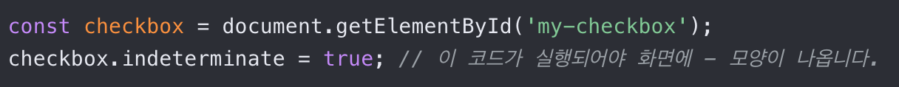

---

- checkbox는 알다시피 html의 input 속성 type=“checkbox”로 인식된다.
- 여기서 특이한 경우를 생각해보자.
  - 다중 선택이 있는 상황에서 전체 선택 체크박스와 개별 선택 체크박스가 있을 때, 개별 선택 체크박스를 선택하면 전체 선택 체크박스는 어떻게 처리해야되는지에 대한 것이다.
  - 별로 문제될 것이 없지않나? 하는 생각이 들 수 있지만, 하위 체크박스는 선택이 된 것이지만, 전체 선택은 되지않은 애매한 상황을 어떻게 처리해야될지가 중요한 문제다.
  - 이 상황을 indeterminate(불확정) 상태라고 한다.
- 어떤 점이 문제가 되는지 알아보자.
  - indeterminate는 checked와 다르게 브라우저가 불확정 상태를 인식하지 못한다. 때문에 반드시 JS의 프로퍼티로만 설정할 수 있다.

- 위와 같이 js로 접근해야한다.
- 따라서 체크박스 공용 컴포넌트를 구현할 때 고려해야될 중요한 요소 중 하나다.
