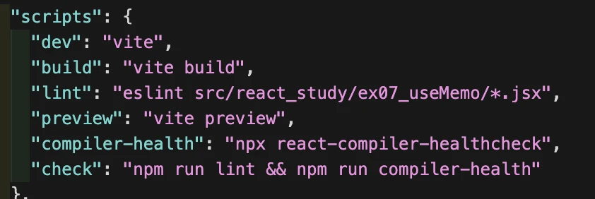
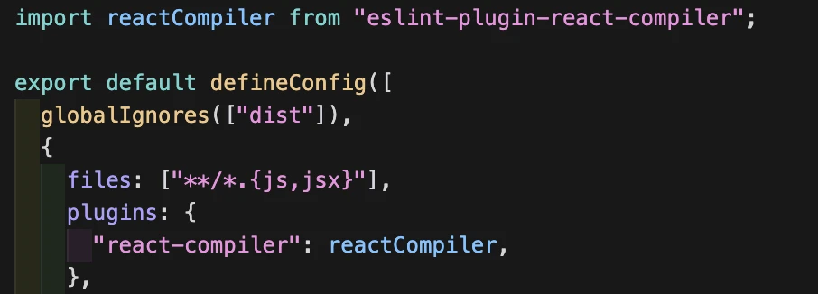
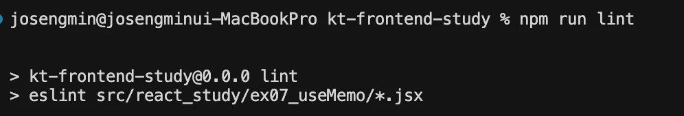
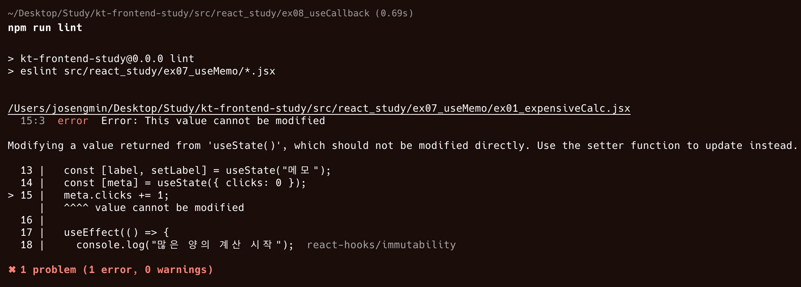

---

오늘은 조금 심오한 내용으로 배워볼까합니다.

금일 수업에는 `useMemo()`, `useCallback()`훅을 배우면서 동시에 '**React Compiler**'를 배웠습니다.

사실 React Compiler는 작년 10월 쯤에 **React v19** 업데이트에서 **정식**으로 React Compiler v1 버전이 출시되었는데요,

React 업데이트 중 가장 눈에 띄는 기능이었습니다.

앞서 수업에서 배웠던 것 처럼 React Compiler는 자동 memoization을 통해 최적화가 가능한데요,

> 공식적으로 "**이런 렌더링 최적화에 힘 쏟을 시간에 비즈니스 로직에 더 집중해라**"라는 React의 철학을 바탕으로 만들어졌습니다.

오늘은 이 `React Compiler`가

'어떻게 코드 내에 useCallback(), useMemo() 등 자동 memoization할 수 있는지?'

"트레이드 오프는 어떻게 되는지?"

에 대한 2가지의 주제로 살펴보도록 하겠습니다.

### 어떻게 자동 memoization이 가능할까?

React Compiler가 최적화할 파일을 탐색하고, 컴파일하기까지의 과정을 보면,

- Babel + babel-plugin-react-compiler

- JSX 소스 코드
- HIR(High-level IR) 생성
- CFG(Control Flow Graph) 분석
- 데이터 흐름 분석 (DFA)
- 최적화 결정
- useMemo() 자동 삽입)

단계로 이루어집니다.

각 흐름을 상세하게 살펴보겠습니다.

**상세 과정**

우선 React Compiler는 JS언어로 작성된 Babel 플러그인입니다. 즉, React Compiler는 Babel에 의존적입니다. (현재는 Rust 언어 컴파일러인 SWC로 개발중이지만 베타 단계라고 합니다.)

이러한 컴파일러는 프로젝트의 모든 JSX 코드를 읽고, Babel 컴파일러가 이해할 수 있는 트리 구조로 변환하기 위해 <strong>TypeScript AST(추상 구문 트리)</strong>를 생성합니다.

변환된 트리구조는 'HIR(High-level Intermediate Representation)생성 단계'로 넘깁니다.

HIR은 사람이 읽기 쉬운 고수준 코드로, 각 표현식에 고유 **id**를 부여하고 정확한 타입 정보를 보존하는 역할을 합니다. 하지만 사람이 직접 읽진 않고 분석용으로 쓰입니다.

```ts
원본 JSX:
const data = fetchUser(id);
const name = data.name;

HIR 표현:
HIR.Block #1:
  ID1: data = Call(fetchUser(id))      // 타입: User | null
  ID2: name = GetProperty(data, 'name') // 타입: string
```

HIR에서 중요한 점은 각 값의 생성/사용 위치를 **id**를 통해 명확히 추적할 수 있다는 것입니다. 컴파일러는 이 정보를 바탕으로 데이터 흐름을 분석합니다.

이후에는 HIR을 코드가 **어떤 순서**로 실행되는지를 '노드'와 '간선'으로 표현한 그래프인 'CFG'로 변환합니다.

컴파일러는 CFG 분석에서 모든 실행 경로를 추적하고, 그래프로 표현하는 단계입니다. 이 과정에서 루프를 감지하고, 'Dead Code(도달 불가능한 코드)'를 제거하고, 조건문 분기 처리 등을 수행하여 각 노드의 실행 순서를 명확히 합니다.

다음 단계인 DFA에서는 각 값의 생명주기를 분석하는 단계인데, 컴파일러는 각 HIR 노드의 생성, 사용, 변경 패턴을 추적합니다.

위 개념을 오늘 배웠던 '**ex01_expensiveCalc.jsx**'에서 `slowSum(n)`을 예시로 들자면,

1.  `slowSum(n)`을 호출합니다. -> HIR로 ID를 부여합니다.
2.  `<h1>{value}</h1>` 텍스트 노드에서 사용됨을 파악합니다.
3.  현재 `slowSum(n)`은 state 변수인 'n'에만 의존한다고 분석합니다.
4.  함수 내부에 부작용(`console.log()` 등)을 파악합니다. -> 만약에 없다면 순수하다고 판단하여 ~~
5.  `slowSum(n)`은 state 변수 n에만 의존적이기 때문에 n 변경 시에만 재계산합니다.

이런 내용들은 **DFA**에서 아래와 같은 정보를 만듭니다.

- value : ID 33 (예시)

- 생성 : N1 - slowSum(n) -> N1이라는 예시 id

- 사용 : JSX 노드

- deps: \[n\] -> state 변수

- pure: true -> 순수성

- readOnly: true

- recomputeOn: n 변경시 재계산

이러한 결과들을 바탕으로 메모이제이션 필요성을 판단합니다.

즉, 앞서 설명한 복잡한 과정을 통해 **React Compiler**는 <strong>'소스 파일 탐색 -> 정적 분석 -> 컴파일 타임에 useMemo() 삽입'</strong>과정을 거치게 됩니다.

### 트레이드 오프(Trade-Off)가 있을까?

그렇다면 자동으로 useCallback(), useMemo(), memo()를 해주는데, 왜 정석처럼 쓰이지 않을까요?

가장 큰 이유 중 하나는 '<strong>조용한 실패(Slient Failure)</strong>'라는 문제 때문인데요, 한 마디로 <strong>"이게 최적화가 되는건지 아닌건지 모르겠다."</strong>라는 상황에 놓입니다.

React Compiler는 최적화에 성공하지 않더라도 <strong>"작동하는 데에는 문제가 없으니까. 최적화만 안되는거잖아."</strong>라는 무책임한 상황이 나오는 거죠.

실제로 useCallback(), useMemo()는 React Compiler를 사용하지 않더라도 정말 많이 쓰이는 React의 훅인데요, 서비스의 규모가 클 수록 개발자가 일일이 확인하기가 힘듭니다.

그렇기 때문에 ESlint 규칙을 강제하는 `@typescript-eslint/react-compiler-healthcheck` lint 라이브러리를 추가로 설치하고 적용해야 합니다.

실제로 이 라이브러리를 수업에서 실습한 내용을 바탕으로 사용해보았습니다.

1.  설치: `npm i eslint-plugin-react-compiler`
2.  package.json에서 lint 명령어 설정 -> 잘 돌아가는지 확인하기 위해서 lint 경로를 '/07_useMemo/\*.jsx' 로 제한했습니다.



3.  eslint.config.js에서 eslint-plugin-react-compiler 설정



여기까지 했을 때 'npm run lint' 명령어로 lint검사를 실행시켜봤습니다.



다행히도 잘 최적화가 되고 있는 것 같습니다.

4.  반대로 억지로 lint 규칙에 위배되도록(React Compiler가 작동하지 않도록) 바꿔보겠습니다.

    const [meta] = useState({ clicks: 0 });
    meta.clicks += 1;

화면이 렌더링 될때마다 clicks 값이 계속 증가하도록 만들어 보았습니다.



의도대로 lint에러가 잡힙니다.

이렇게 lint에러가 잡히면, React Compiler가 아예 컴파일 대상에서 제외해버리기 때문에 최적화가 일어나지 않게 됩니다.

실제로 '!'을 추가하는 setLabel에 memoization이 잡히지 않았습니다. (증명에 동영상이 필요한데 안올라가네요)

하지만, 그렇다고 코드에 에러가 발생하여 실행되지 않거나 하는 문제는 없기 때문에 명령어를 따로 입력해주지 않는 이상 최적화가 되는지 알 수 없습니다. (.husky로 commit 시에 자동으로 명령어가 실행되도록 해볼 수도 있을 것 같습니다.)

두 번째의 이유는 실제로 가장 치명적일 수 있는 **"기존 코드베이스와의 충돌 문제"** 때문입니다.

레거시 프로젝트에서는 다양한 **서드파티 라이브러리**를 사용하기 때문에 **호환성**을 생각해야합니다.

또한 첫 번째 이유에서 파생되는 이유로 React Compiler가 잘 수행하는지 확인이 번거롭기 때문에 테스트 커버리지가 부족한 이유도 있을 것입니다.

이러한 트레이드 오프로 인해 React Compiler를 사용하는 곳도 있지만, 레거시 코드베이스를 뜯어내기 힘든 도메인이나 회사에서는 사용하기 어렵습니다.

따라서 완벽한 코드베이스에서 React Compiler가 빛나기 때문에 잘 선택하고 고려해야 할 문제라고 생각합니다.

오늘 **느낀점** : 다양한 기술이 새로 도입되면 그에 따른 문제들이 어디서나 나타나기 마련인데, 그럴 때 어떻게 **잘 우회해서 할 지 or 버릴지**를 생각해보는 것이 중요할 것 같습니다. 또, React Compiler가 잘 잡아줘서 비즈니스 로직에 집중할 수 있는 것은 큰 장점이지만, 그렇게까지 연산 최적화를 신경써볼만한 규모의 프로젝트를 진행해본 적이 없고, 프론트엔드에서 스냅샷, E2E 테스트 코드를 작성해본 경험이 없기 때문에 크게 체감이 되지는 않습니다.

매번 React, Vite, TypeScript 등 다양한 프로덕트가 업데이트 함에 따라 매번 새로운 것을 배우고 접해야합니다. 개발자의 숙명이니 만큼 기존 기술을 탄탄하게 배우면서 새로운 기술을 잘 적용할 줄 아는 것은 매우 고단하고 평생 그 프로세스를 거쳐야 합니다. 물리 법칙은 그렇게 쉽게 바뀌지 않는데 말이죠. 꾸준히 재미를 갖고 배우는 것이 답인 것 같습니다. 화이팅합시다.
