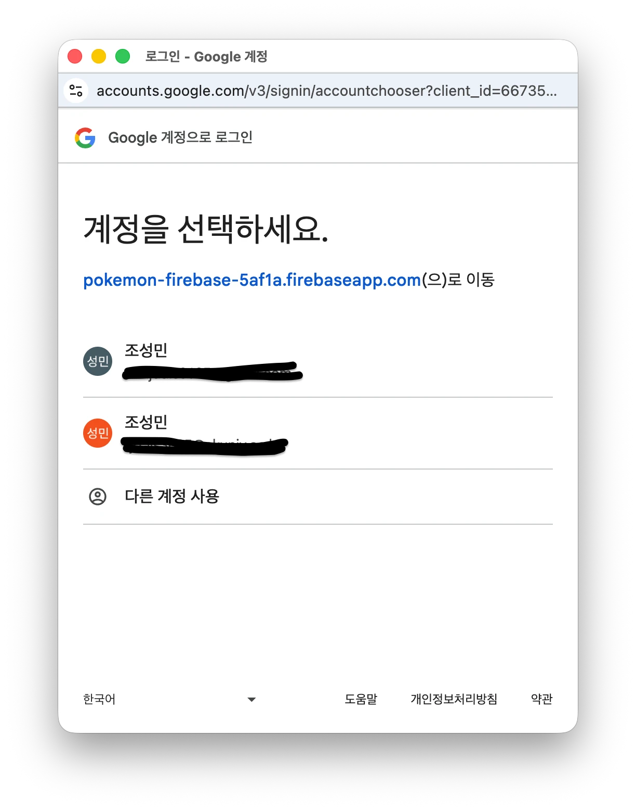

---

금일은 지난 수업에 이어 **firebase기반 로그인 기능**을 구현하였습니다.

firebase를 통해 <strong>자체 로그인(이메일/비밀번호)</strong>과 **Google OAuth** 로그인을 쉽게 구현할 수 있었는데요,

실제 서비스들을 보면, 카카오, 네이버, 구글, 애플 등 다양한 소셜 로그인 방식으로 서비스 로그인을 제공하는 경우가 많습니다.

한편, 일부 서비스에서는 OAuth 인증 방식으로만 가입이 가능한 서비스들이 있지만, 여전히 서비스 내부에서 별도 회원가입/로그인 기능을 제공하는 경우가 많습니다.

그렇다면 과연 두 방식은 어떤 차이가 있을까요?

이것에 대해 설명하기 전에 먼저 '<strong>인증(Authentication)</strong>'과 '<strong>인가(Authorization)</strong>'의 개념을 알아야 하는데요,

> **인증**은 쉽게 말해서 '**당신은 누구십니까**?'를 확인하는 과정입니다.

웹 서비스에 접속하는 사용자가 정말로 자신이 주장하는 사람인지 확인하는 절차입니다.

(ex. 아이디/비밀번호, 소셜 로그인(OAuth), 2단계 인증(2FA, MFA), ...)

위치 : React같은 프론트엔드에서는 **로그인 화면**을 통해 서버로 인증을 시도하고, 서버가 인증에 성공하면, 세션(Session)이나 JWT 토큰을 발급합니다.

> **인가**는 '**당신은 무엇을 할 수 있나요?**'를 결정하는 과정입니다.

즉, '인증'이 '당신이 등록된 사용자임을 확인했습니다.'의 과정을 거친 후에 '당신은 얼마나 권한을 갖고있나요?'를 판단하는 과정입니다.

대표적으로 <strong>RBAC(Role-Based Access Control)</strong> : 사용자 역할(Role) 기반의 단위로 구분하는 기능,

<strong>ABAC(Attribute-Based Access Control)</strong>: 나이, 소속, 결제 상태 등 특정 속성에 따라 권한을 주는 기능이 있습니다.

위치 : React에서 보통 라우팅(페이지 접근 제어) 단계에서 나타납니다. 예를 들어 관리자 페이지를 일반 사용자가 접근하지 못하도록 막는 것이죠.

따라서 앞서 수업 시간에 구현했던, 로그인/회원가입 및 소셜 로그인(OAuth)는 내용은 '인증' 단계이기는 하지만, 권한에 따라 서버에서 사용자의 '인가'를 판단하는 요소가 되는 것이죠.

그렇다면 소셜 로그인과 자체 로그인을 서버에서는 어떻게 인증하고, 권한을 부여하는 것일까요?

**자체 로그인**

1.  우선 자체 로그인은 사용자 즉, 클라이언트가 서버로 로그인 요청을 보냅니다. 이때 **요청 바디에는 이메일/비밀번호**를 보내고, 서버는 인증관련 auth 데이터베이스에서 실제 등록된 사용자인지를 확인합니다.
    
2.  등록된 사용자라면, **응답 바디에 accessToken**(혹은 r**efreshToken**과 함께)을 보냅니다.
    
3.  서버 응답으로부터 온 accessToken과 refreshToken은 **브라우저의 스토리지에 저장할 수 있습니다**. ( ex. 로컬 스토리지, 세션 스토리지, 쿠키, ...)
    
4.  이후에 클라이언트가 인증 권한이 필요한 api 요청을 서버로 보내면, 서버는 요청 헤더 : Authorization헤더에 붙은 토큰을 검증해서 유효하면 현재 사용자가 누구인지 식별하고 그에 맞는 권한을 적용합니다. 즉, **인증과 인가 과정**을 거칩니다.
    

따라서 자체 로그인은 구현 방식에 따라 다르겠지만, 대개로 **자체 서버가 인증과 인가를 관리하는 주체**가 됩니다.

하지만 소셜 로그인 인증, 인가 방식은 조금 다릅니다.

**소셜 로그인**

1.  자체 로그인과 마찬가지로 서버로 로그인 요청을 보냅니다.(Google 로그인이라고 하겠습니다.)
    
2.  하지만, 이때 서버에게 인증을 요청하는 것이 아니라 '**GoogleAuthGuard**'라는 Google 전략을 이용하여 사용자를 **구글 인증 페이지로 리다이렉트** 시킵니다.
    
    
    
    바로 위 화면이죠.
    
3.  사용자는 구글의 로그인 페이지에서 자신의 계정으로 로그인하고, 애플리케이션에 대한 접근 권한(동의)를 부여합니다.
    
4.  인증이 완료되면, 구글은 사용자 브라우저를 백엔드의 `/google/callback`엔드페인트로 리다이렉트합니다. 이 요청에는 **구글이 발급한 인증 코드나 사용자 정보**가 함께 포합됩니다.
    
5.  이때 서버에서는 **구글에서 받아온 사용자 정보를 검증하고, 저장**합니다. 이 정보를 바탕으로 자체 로그인 인증 절차 계층에서와 동일하게 accessToken(방식에 따라 refreshToken도 같이)을 생성합니다.
    
6.  생성된 토큰은 쿼리 파라미터로 사용자에게 전달됩니다.
    
7.  React에서는 이 URL의 쿼리 파라미터를 추출하고, 브라우저에 보관하여 사용합니다.
    

따라서 인증 주체는 <strong>소셜서버(IdP)</strong>가 됩니다.

> 정리하자면, 자체 로그인과 소셜 로그인의 가장 큰 차이점은 '**누가 사용자 인증을 받고, 누가 토큰을 관리하느냐**'에 있습니다.
> 
> *   **자체 로그인**에서는 우리 애플리케이션의 서버(또는 Firebase auth)가 이메일/비밀번호를 직접 검증하고, 그 결과로 우리 서비스용 JWT를 발급/관리합니다.
>     
> *   반면 **소셜 로그인**에서는 구글/카카오와 같은 외부 제공자가 먼저 인증하고, 서버는 그 결과를 바탕으로 auth 토큰을 발급해 관리합니다.
>     

프론트엔드 입장에서는 '로그인 성공 후 브라우저가 토큰을 보관하고, Authorization헤더에 실어서 서버로 보내는 흐름은 비슷해보일 수 있지만, 실제로 **인증의 책임 주체와 토큰 생명 주기를 설계하는 주체가 다르다**는 점을 이해하는 것이 중요하다고 생각합니다.
