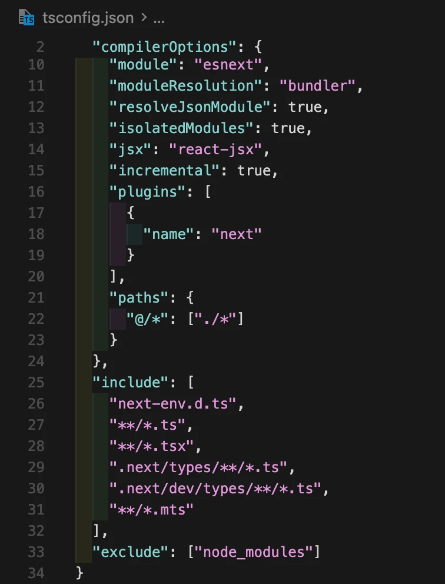

---

오늘은 수업 시간에 좀 많은 내용을 한꺼번에 많이 배웠는데요,

가장 기본이 되는 '**타입스크립트**'와 '**렌더링 방식**'에 대해 알아보겠습니다.

### **타입스크립트의 동작 원리**

우선, 대다수의 프로그래밍 언어는 어떻게 동작할까요?

기본적으로 사람이 프로그래밍 언어를 작성하면, 컴퓨터가 이해할 수 있는 언어로 바꿔야하는데요, 이를 **컴파일**이라고 합니다.

기계어(바이트 코드) 즉, 컴퓨터가 이해하기 쉬운 형태로 변환하는 과정을 '컴파일'이라고, 하고 이를 수행하는 역할을 하는 것을 '컴파일러'라고 합니다.

컴파일러는 ‘사람’이 작성한 코드를 **바로 바이트 코드로 변환**하는 것이 아니라 '<strong>AST(Abstract Syntax Tree)</strong>'라는 ‘<strong>추상문법(구문)트리</strong>’로 변환합니다.

여기서 ‘**AST**’란 무엇일까요?

**AST**는 **추상문법트리**로, 코드의 공백이나 주석, 탭 등의 코드 실행에 관계없는 요소들을 전부 제거하고 트리형태의 자료구조에 코드를 쪼개서 저장해놓은 형태입니다.

이렇게 코드를 AST로 변환하고 나면, 컴파일러가 AST를 바이트 코드로 변환하고 컴파일이 종료됩니다.

대부분의 코드들이 이러한 과정을 거쳐 컴퓨터가 이해하고, 실행하는 것이죠.

그렇다면 <strong>타입스크립트(ts)</strong>는 어떻게 실행될까요?

**TypeScript**는 독특한 컴파일 과정을 거치는데요,  
우선 다른 언어들과 동일하게 먼저 타입스크립트 코드를 AST로 변환합니다. 여기까지는 다른 언어들과 동일한 방식으로 진행됩니다.

그런데, 그 다음에 AST를 바이트코드로 바로 변환하는게 아니라 AST를 보고 코드 상에 타입 오류가 없는지를 검사하는 ‘**타입 검사**’라는 과정을 거칩니다.

만약 코드에 잘못된 타입을 넣거나, 해당 타입에서 실행 불가능한 함수(메서드)를 넣는 것처럼 코드의 **타입 에러**가 있다면, ‘**타입 검사**’과정에서 실패하게 되고, **컴파일이 중단**됩니다.

타입 검사에 해당하는 코드들은 전부 `tsconfig.json` 파일에 ‘`include`’속성 경로에 의해 결정됩니다.

만약 ‘타입 검사’과정에서 타입오류가 없는 **정상적인 코드**라면, **AST를 바이트코드로 바로 변환하지 않고** **JavsScript로 변환**합니다. 그리고 컴파일이 종료됩니다.

이렇게 만들어진 자바스크립트 코드는 NodeJS나 웹 브라우저로 실행하면, ‘대다수의 언어들’과 동일한 컴파일 과정을 다시 거쳐 실행됩니다.

즉, 타입스크립트는 타입 오류가 없는 정제된 자바스크립트를 반환하는 역할을 하는 것이죠.

이러한 타입스크립트 코드들은 대개로 ‘`dist`’라는 폴더에 순수 자바스크립트로 저장되는데요, 타입스크립트 코드들은 자바스크립트로 컴파일하는 과정에서 타입과 관련된 문법들은 전부 제거하기 때문입니다.

### 렌더링 방식

클라이언트 렌더링 방식에는 다양한 전략이 있습니다.

가장 흔히 사용하는 렌더링 전략에는 React를 활용한 'CSR(Client Side Rendering)'방식, JSP를 이용한 'SSR(Server Side Rendering)'방식, 등 다양한 렌더링 전략이 있습니다.

각 렌더링 방식은 서비스의 사용자 경험, SEO, 서버 부하 등 **서비스 철학**과 연관되어 설계가 되고 **최적화**되어 구현되는데요,

각 렌더링 방식의 차이점을 이해하기 전에 **렌더링 방식의 동작 원리**에 대해 알아야 합니다.

클라이언트-서버 구조를 **세 가지의 역할**로 구분할 수 있습니다.

- **서버** : 서비스 제공자 (정적 파일들, html, js번들 파일, api 요청에 응답)
- <strong>브라우저(클라이언트)</strong> : 브라우저 애플리케이션 (사용자가 웹을 이용할 때 쓰는 프로그램)
- **사용자** : 서비스 요청자 (서버에 서비스를 요청하고 응답을 사용하는 쪽)

이러한 역할에서 브라우저가 서버로부터 html, css, js파일을 받아서 이를 해석하고 화면에 띄워주는 과정을 '**렌더링**'이라고 합니다.

결국 여기서 CSR과 SSR의 렌더링 방식에서 **차이**가 발생합니다.

예시를 들어보겠습니다.

**#1 사용자가 CSR 서비스에 접속했을 때**

1.  사용자가 서비스 url에 접속합니다.
2.  클라이언트는 서버로부터 빈 껍데기의 index.html 파일을 받습니다. 빈 화면이 렌더링되는 것이죠.
3.  서버는 뒤이어 js로 작성된 코드를 묶어놓은 js 번들 파일을 받아 제대로된 화면을 렌더링합니다.
4.  사용자가 화면에 어떠한 이벤트를 실행하면 브라우저에서 js 번들 중 해당되는 로직을 실행합니다.

이러한 과정 덕에 CSR은 다른 페이지로 접근했을 떄 굉장히 빠른 속도로 js를 갈아끼웁니다. 브라우저에 번들이 있으니 서버로 재요청을 할 필요가 없겠죠.

하지만 js번들 크기가 커질수록 초기 렌더링 속도는 느려집니다.

즉, js 번들 파일의 크기에 따라 초기 렌더링 속도가 달라지는 것이죠. 이는 치명적인 단점이 될 수 있습니다.

'<strong>FCP(First Content Paintful)</strong>'라고 하는 웹페이지의 성능 지표가 있는데요, 말 그대로 '초기 요청 시작 시점으로부터 컨텐츠가 화면에 처음 나타날때까지 걸리는 시간'이라고 합니다.

초기 렌더링 속도가 느릴 수록 사용자는 빠른 속도로 페이지에 벗어나게 됩니다.

따라서 React의 CSR에서 초기 렌더링 속도 최적화를 위해 Lazy Loading(지연 로딩)을 걸어서 js 용량을 줄이는 전략을 사용하기도 합니다.

**#2 사용자가 SSR 서비스에 접속했을 때**

1.  사용자가 서비스 url에 접속합니다.
2.  클라이언트는 동일하게 서버에게 html파일을 요청합니다.
3.  이때, 브라우저는 처음부터 html파일과 js파일로 조합해서 사용자에게 렌더링하는 것이 아니라, 이미 서버로부터 만들어진 html을 받습니다.
4.  사용자는 새로운 페이지로 이동할때마다 서버로부터 만들어진 html을 받게됩니다.
5.  이후에는 'hydration(수화)과정'을 거치게 되는데요, 서버로부터 받은 html로는 사용자가 아무런 이벤트, 인터렉션도 실행할 수 없습니다. 따라서 JS파일을 서버로부터 받아야합니다. 마치 html이라는 매마른 땅에 js라는 물이 스며드는 것과 같은 것이죠. 이러한 수화 과정을 <strong>TTI(Time to Interactive)</strong> : '**상호작용이 가능해지는 시점**'이라고 합니다.

이러한 과정 덕에 CSR에 비해 초기 렌더링 속도가 빠릅니다. FCP속도도 상당히 향상됩니다.

하지만, 페이지를 이동 즉, 페이지를 요청할때마다 서버로 요청을 해야하기 때문에 이동시에 UX가 매우 안좋은 편입니다.

SSR의 단점이자 **CSR**의 강점인, **SPA 방식의 빠른 네비게이션과 상태 전환**.

CSR의 단점이자 **SSR**의 강점인 **초기 렌더링 속도**.

각 방식의 강점만 사용하여 설계할 수 있는 프레임워크가 **Next.js**이고, 이를 Next.js의 '**사전 렌더링**'이라고 합니다.

Next.js에서도 서버에서 미리 만들어진 HTML을 받은 뒤 JS 번들을 하이드레이션하는 과정은 동일합니다. 하지만 전통적인 SSR처럼 페이지 이동마다 전체 HTML 문서를 다시 받아오는 대신, 하이드레이션 이후에는 클라이언트 라우팅을 통해 필요한 데이터만 서버에 요청하여 화면을 갱신할 수 있습니다.

코드로는 '`use server`'(default), '`use client`'로 설정할 수 있습니다.

이외에도 Next.js의 렌더링 전략은 정말 다양합니다.

SSG, ISR, PPR, 스트리밍 등 React와 다른 '**프레임워크**'라는 점에서 그만큼더 알아가야할 것들이 많다고 생각하고, 더 열심히 해보겠습니다.
