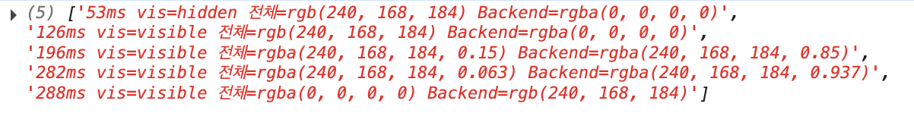
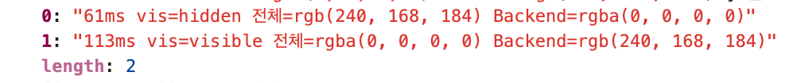

import Video from "@/components/mdx/Video.astro";

이 블로그는 정적 사이트라서, 기능을 하나 추가할 때마다 가장 먼저 따지는 것이 최적화입니다.<br />
글 목록에 태그 필터와 검색을 붙이면서, 선택한 필터를 URL에 남겨야 하는 순간이 왔습니다.

> React Router나 Next.js의 `useSearchParams()`를 쓰면 간단하지만, 이 페이지 하나를 위해 React 런타임까지 내려받게 해야 할까?

React를 쓰면 편하지만, 브라우저가 React 코드를 추가로 내려받고 실행해야 합니다.<br />
그래서 이 기능을 바닐라 JS로 직접 구현하기로 했습니다.

이 글에서는 훅 없이 URL과 화면 상태를 동기화한 구조와, 그 과정에서 생긴 칩 깜빡임 문제를 **프레임 단위로 측정해 해결한 과정**을 정리합니다.

---

# 상태를 URL에 저장하는 구조

## <mark>상태 변수가 화면과 URL의 기준이 된다</mark>

구조를 한 줄로 요약하면 <strong>"상태 변수로 화면을 결정하고, 그 상태를 URL에 저장했다가 필요할 때 복원하는 방식"</strong>입니다.

| 구성      | 역할                       |
| --------- | -------------------------- |
| 상태 변수 | 현재 작업 중인 내용        |
| 화면      | 작업 내용을 보여주는 결과  |
| URL       | 현재 작업 내용을 저장한 기록 |

여기서 핵심은 화면과 URL이 따로 움직이지 않고, **항상 같은 상태를 표현**해야 한다는 점입니다.

### 상태 변수

예를 들어 상태 변수가 다음과 같다고 가정하겠습니다.

```typescript
let activeLabel = "알고리즘"; // 큰 분류
let activeSubTag = "DP"; // 세부 태그
let searchQuery = "피보"; // 검색어
let currentPage = 2; // 페이지
```

이 네 변수는 "알고리즘 분류에서 DP 태그를 선택하고, '피보'를 검색한 결과의 2페이지"라는 뜻입니다.<br />
즉 화면을 만들기 위한 설정값이고, 실행 중인 화면 상태의 <strong>단일 진실 공급원(SSOT)</strong>으로 사용합니다.

<br />

### URL로 옮기기

같은 상태를 URL로 표현하면 다음과 같습니다.

```text
/blogs?tag=알고리즘&sub=DP&q=피보&page=2
```

각 파라미터가 상태 변수 하나에 대응합니다.<br />
이렇게 저장해 두면 URL을 복사하거나 새로고침해도 같은 필터를 복원할 수 있습니다.

이를 코드로 구현했을 때 다음과 같이 나타납니다.

```typescript
// 현재 필터 상태를 URL에 기록. 기본값은 쿼리에서 생략
function writeUrl(mode: "push" | "replace") {
  const params = new URLSearchParams();
  if (activeLabel) params.set("tag", activeLabel);
  if (activeSubTag) params.set("sub", activeSubTag);
  if (searchQuery) params.set("q", searchQuery);
  if (currentPage > 1) params.set("page", String(currentPage));

  const query = params.toString();
  const next = query ? `${location.pathname}?${query}` : location.pathname;
  if (next === location.pathname + location.search) return;

  if (mode === "push") history.pushState(null, "", next);
  else history.replaceState(null, "", next);
}
```

#### Q. 왜 굳이 이렇게까지 해야하나요?

기존 방식은 상태를 URL에 저장하지 않으면 주소는 항상 `/blogs`로 고정되고, 새로고침하는 순간 사용자가 무엇을 선택했는지 알 수 없기 때문입니다.

<br />

### 칩을 클릭했을 때의 흐름

사용자가 필터 칩을 누르면 항상 같은 순서를 거칩니다.

```text
칩 클릭
  ↓
상태 변경    →  activeLabel = "알고리즘"
  ↓
화면 갱신    →  applyState()
  ↓
URL 기록     →  writeUrl("push")
```

```typescript
function setLabel(label: string) {
  activeLabel = label;
  activeSubTag = "";
  currentPage = 1;
  applyState();
  writeUrl("push");
}
```

반대로 새로고침이나 뒤로 가기로 들어왔을 때는 `readUrl()`이 URL을 읽어 상태 변수를 채우고, 같은 `applyState()`로 화면을 그립니다.<br />
화면을 그리는 경로가 하나뿐이라 URL과 화면이 불일치하는 일이 없습니다.

---

# 새로고침을 했더니 '전체' 칩이 깜빡였다?

## 문제 상황

이 구조에는 문제가 하나 있었습니다.<br />
새로고침하거나 주소창에서 쿼리를 직접 바꿔 들어오면, '전체' 칩이 잠시 선택됐다가 원래 선택한 칩으로 돌아오는 깜빡임이 보였습니다.

<Video src="/videos/query-parameter-without-hook/1.mp4" />

원인을 파악했더니, HTML은 빌드 시점에 만들어지므로 항상 '전체'가 선택된 상태로 내려옵니다.<br />
때문에 스크립트가 URL을 읽고 칩을 옮기기 전까지, 그 기본 상태가 화면에 그대로 노출된 것입니다.

그래서 쿼리로 진입한 경우에는 상태를 읽고 렌더가 끝날 때까지 칩 영역을 `visibility: hidden`으로 숨겨 두기로 했습니다.

```css
.posts-page[data-url-pending]
  :is(.posts-toolbar, .posts-content, #posts-pagination) {
  visibility: hidden;
}
```

<br />

### Q. 다른 방법은요?

대안도 몇 가지 있었지만, 정적 사이트에는 맞지 않았습니다.

- **서버에서 쿼리를 읽어 렌더링** : 요청마다 서버가 HTML을 만들어야 해서 정적 출력의 장점이 사라집니다.
- **필터 조합마다 정적 페이지 생성** : 태그, 세부 태그, 페이지 조합만큼 페이지가 늘어나고, 검색어는 미리 만들 수도 없습니다.
- **React 아일랜드로 필터 영역 구현** : 처음에 피하려던 React 런타임을 다시 내려받게 됩니다.

<br />

### 결과

숨김 처리를 넣은 뒤에도 **미세한 깜빡임**이 남아 있었습니다.<br />
눈으로는 원인을 알기 어려워서, 실제로 **어떤 타이밍에 무엇이 바뀌는지 측정**해 보기로 했습니다.

## <mark>실험 : 프레임 단위로 칩 색상 측정하기</mark>

측정 코드는 AI의 도움을 받아 작성했습니다.

원리는 다음과 같습니다.

- 측정할 페이지를 **같은 사이트의 다른 페이지 안에 iframe으로 띄웁니다.** 바깥 페이지는 새로고침되지 않으므로, 바깥 스크립트가 iframe이 로드되는 과정을 처음부터 끝까지 지켜볼 수 있습니다.
- `requestAnimationFrame`은 브라우저가 화면을 그리기 직전, 프레임마다 한 번씩 호출됩니다. 60Hz 화면이라면 약 16ms 간격입니다. 여기서 iframe 안 요소를 읽으면 프레임 단위 기록이 됩니다.
- 클래스 이름이 아니라 `getComputedStyle`로 **실제 계산된 값**을 읽어야 transition 중간값까지 잡힙니다.
- 값이 바뀐 프레임만 기록해서 로그를 짧게 유지합니다.

```javascript
await new Promise((resolve) => {
  const log = [];
  const f = document.createElement("iframe");
  f.style.cssText = "width:1200px;height:800px";
  document.body.appendChild(f);
  // 매번 새 요청이 되도록 시간값을 붙여 캐시 회피
  f.src = "/blogs/?tag=Backend&r=" + Date.now();

  const t0 = performance.now();
  let last = "";

  function tick() {
    const d = f.contentDocument;
    const all = d?.querySelector('.chip[data-chip=""]'); // '전체' 칩
    const be = d?.querySelector('.chip[data-chip="Backend"]'); // 'Backend' 칩
    const toolbar = d?.querySelector(".posts-toolbar");

    if (all && be && toolbar) {
      const cs = (el) => f.contentWindow.getComputedStyle(el);
      const s =
        `vis=${cs(toolbar).visibility} ` +
        `전체=${cs(all).backgroundColor} Backend=${cs(be).backgroundColor}`;
      if (s !== last) {
        log.push(Math.round(performance.now() - t0) + "ms " + s);
        last = s;
      }
    }

    if (performance.now() - t0 < 4000) requestAnimationFrame(tick);
    else {
      f.remove();
      resolve(log);
    }
  }
  requestAnimationFrame(tick);
});
```

로그의 각 줄은 다음 값을 담고 있습니다.

| 값                  | 의미                                                    |
| ------------------- | ------------------------------------------------------- |
| `ms`                | iframe을 만든 뒤 지난 시간                              |
| `vis`               | 칩 영역의 visibility                                    |
| `rgb(...)`          | 칩의 최종 배경색                                        |
| `rgba(...)`         | 색이 바뀌는 중간값. 여러 줄 나오면 transition 진행 중   |
| `rgba(0, 0, 0, 0)`  | 투명                                                    |

URL로 요청한 필터 칩은 `'Backend'`입니다.



**결과** : 숨김이 풀린 직후 약 120ms 동안 '전체' 칩의 배경이 분홍에서 투명으로 서서히 바뀌었습니다. 알파 값이 0.15, 0.063처럼 줄어드는 중간값이 여러 프레임에 걸쳐 기록됐습니다.

## 원인 분석

`visibility: hidden`은 화면에서 가려질 뿐, 스타일 계산은 그대로 합니다.<br />
그래서 숨겨진 동안에도 '전체' 칩은 **분홍색**으로 계산되어 있었습니다.

이해를 위해 세부적으로 설명해보겠습니다.

페이지의 메인 스크립트는 같은 순간에 **두 가지**를 바꿉니다.

- 활성 클래스를 '전체'에서 'Backend'로 옮긴다.
- 숨김 속성(`data-url-pending`)을 제거한다.

브라우저는 이 둘을 따로 처리하지 않고, 다음 스타일 계산에서 **한 번에** 반영합니다.

```text
숨김 중(hidden)  →  '전체' = 분홍색 (보이지 않음)
  ↓
스크립트 실행  →  클래스 이동 + 숨김 해제 (같은 순간)
  ↓
스타일 계산    →  '전체'가 보이는 상태에서 분홍색 → 투명색으로 변경
  ↓
transition    →  0.12s 동안 분홍색이 서서히 빠지는 모습이 보임
```

문제는 색이 바뀌는 시점이 숨김이 풀린 **뒤**였다는 점입니다.<br />
`chip.css`의 `transition: background-color 0.12s` 때문에, 이 색 변화가 즉시가 아니라 0.12초에 걸쳐 화면에 그려졌습니다.

즉, <strong>"칩이 바뀌는 타이밍에 '전체' 칩은 분홍색으로 계산되어 있었고, 이를 트랜지션이 애니메이션으로 보여 주면서, 보이지 않아야 할 '전체'의 분홍색이 잠깐 드러난 것입니다."</strong>

---

# 해결 : 숨김 해제 타이밍 바꾸기

## <mark>transition을 끄고, 최종 스타일을 확정한 뒤 숨김 해제</mark>

해결 방향은 **숨겨진 동안에는 transition을 끄고, 최종 스타일을 먼저 확정한 뒤에 숨김을 해제**하는 것입니다.

```css
.posts-page[data-url-pending]
  :is(.posts-toolbar, .posts-content, #posts-pagination) {
  visibility: hidden;
}

/* 숨김 해제 시 칩, 사이드바 색 전환 애니메이션이 보이지 않도록 트랜지션 비활성화 */
.posts-page[data-url-pending] * {
  transition: none !important;
}
```

```typescript
// 초기 실행
readUrl();
applyState();
writeUrl("replace");

// 트랜지션이 꺼지고 나서야 숨김 해제
const postsPage = document.querySelector<HTMLElement>(".posts-page");
if (postsPage) {
  void postsPage.offsetHeight;
  postsPage.removeAttribute("data-url-pending");
}
```

<br />

### 동작 순서

```text
HTML 로드        →  data-url-pending 있음 (숨김 + transition 꺼짐)
  ↓
readUrl / applyState  →  활성 클래스를 Backend로 이동
  ↓
offsetHeight     →  지금 스타일을 즉시 계산 (transition 없이 색 확정)
  ↓
removeAttribute  →  숨김 해제. 색은 이미 최종값이라 전환할 변화가 없음
```

처음 HTML이 로드될 때 `.posts-page`는 `data-url-pending` 속성을 갖고 있습니다.<br />
이 속성이 있는 동안에는 영역이 숨겨지고, 내부 요소의 transition도 모두 꺼집니다.

<br />

### Q. 왜 offsetHeight가 필요한가요?

`offsetHeight`는 요소의 실제 높이(테두리 포함)를 픽셀 단위로 돌려주는 읽기 전용 속성입니다.<br />
여기서는 높이 값이 필요한 게 아니라서, 결과를 `void`로 버리고 **읽는 행위 자체**만 이용합니다.

그런데 읽기만 하는데도 왜 효과가 있을까요?

브라우저는 성능을 위해 DOM과 스타일 변경을 바로 계산하지 않고 모아 두었다가, 다음 렌더링 직전에 한 번에 처리합니다.<br />
그런데 `offsetHeight`처럼 레이아웃 값을 읽는 요소가 들어간다면, 정확한 값을 돌려주기 위해 쌓아 둔 변경을 **그 자리에서 강제로 계산**해야 합니다. 이를 <strong>강제 reflow(리플로우)</strong>라고 합니다.

이 성질 덕분에 `offsetHeight` 한 줄이 스타일 계산을 두 번으로 나누는 경계가 됩니다.

```text
[`offsetHeight` 없음]
  클래스 이동 + 숨김 해제  →  한 번에 계산 (transition 켜진 상태에서 색 변경)
                           →  분홍색이 서서히 바뀌는 애니메이션 발생

[`offsetHeight` 있음]
  클래스 이동             →  여기서 즉시 계산 (transition 꺼진 상태에서 색 확정)
  숨김 해제               →  transition만 다시 켜짐, 바뀔 색이 없음
                        →  애니메이션 없음
```

즉, `offsetHeight`는 <strong>"transition이 꺼져 있는 동안 색 변경을 먼저 끝내라"</strong>고 브라우저에 신호를 주는 역할입니다.

## 적용 후 측정

같은 측정 코드로 다시 확인했습니다.

**결과** : `hidden`에서 `visible`로 넘어가는 시점에 칩 색이 이미 최종값으로 바뀌어 있었고, 중간값(`rgba`)은 더 이상 기록되지 않았습니다.



실제 화면에서도 새로고침을 반복해 봤지만 깜빡임이 사라졌습니다.

<Video src="/videos/query-parameter-without-hook/2.mp4" />

---

## 마치며

React 훅 없이 상태 변수, 화면, URL을 하나의 흐름으로 묶어 정적 블로그의 필터를 구현했고, 그 과정에서 생긴 깜빡임을 측정으로 추적해 해결했습니다.

직접 측정하면서 두 가지가 확실해졌습니다.

- `visibility: hidden`은 화면에서 숨길 뿐 스타일 계산과 transition까지 멈추지는 않는다.
- 브라우저가 스타일 변경을 모아서 처리하기 때문에, 변경의 순서가 중요할 때는 강제 리플로우로 중간 상태를 확정해야 한다.

다음 글에서는 이 블로그의 Vercel 배포 용량을 줄인 과정을 정리할 예정입니다.
