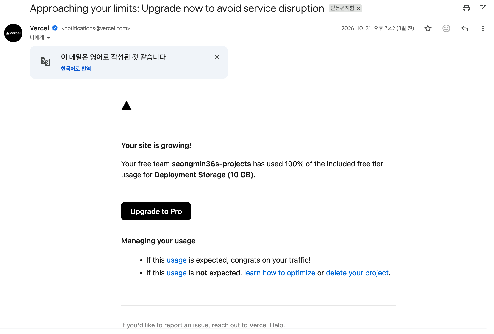
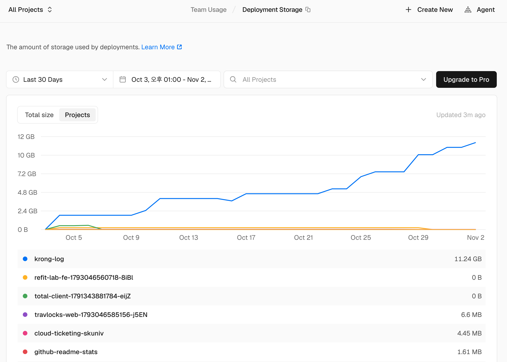
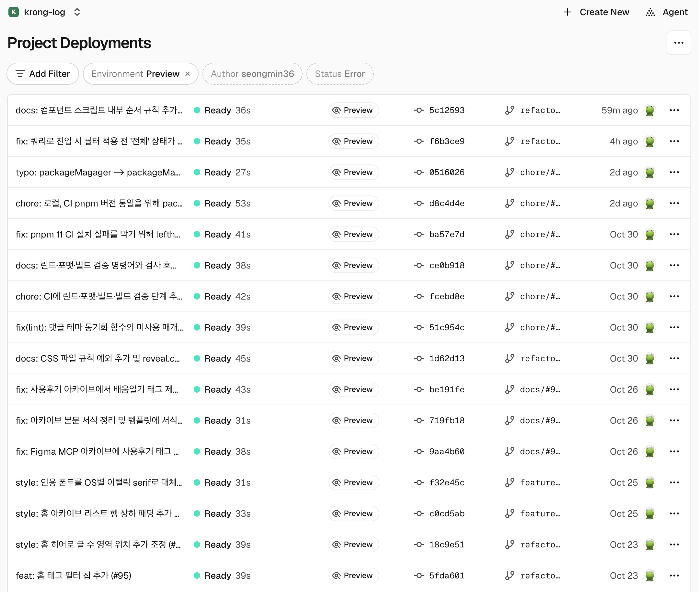
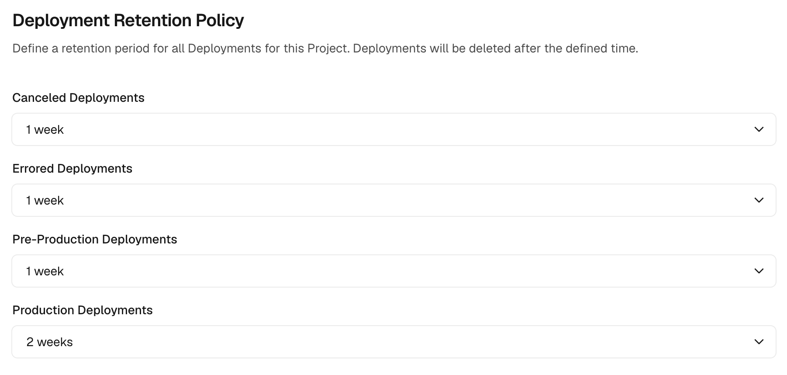
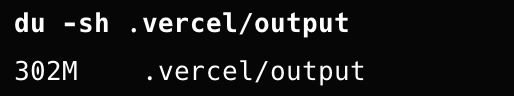
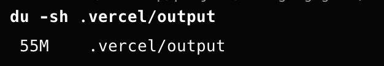
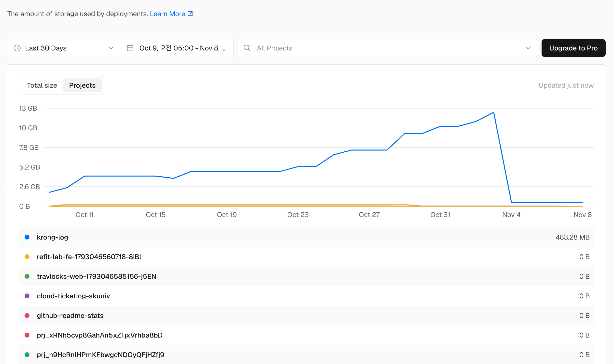
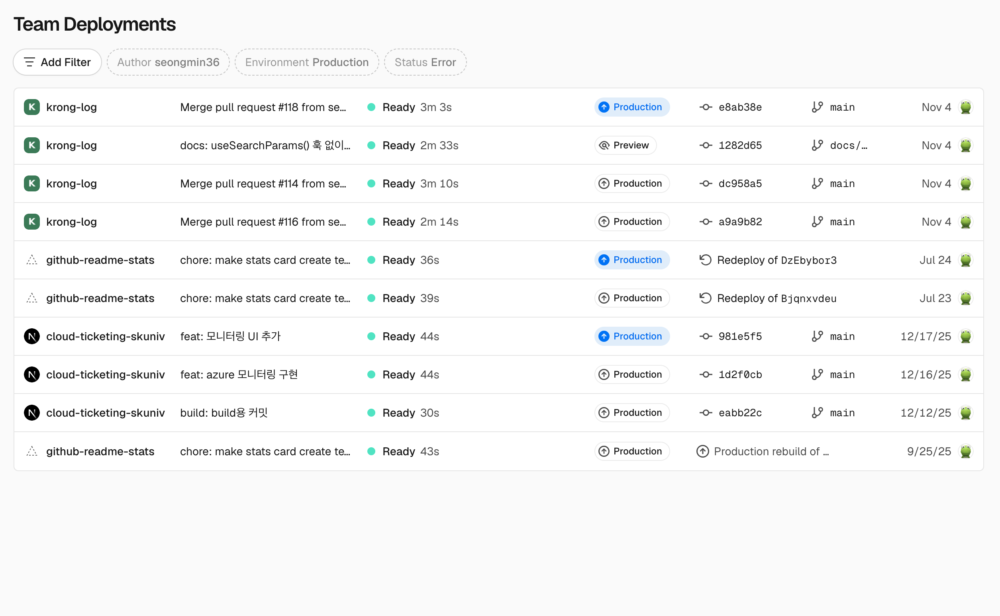

import LinkCard from "@/components/mdx/LinkCard.astro";
import GithubCard from "@/components/mdx/GithubCard.astro";
import Tooltip from "@/components/ui/Tooltip.astro";

이 블로그는 Vercel로 배포하고 있는데, 어느 날 Vercel에서 메일이 한 통 도착했습니다.



Hobby 플랜에 포함된 <strong>Deployment Storage(10GB)</strong>를 100% 사용했다는 내용이었습니다.



여러 프로젝트를 배포해 왔지만, 용량 대부분을 차지한 것은 krong-log(이 블로그) 하나였습니다.<br />
그래프에도 나타나듯이 나머지 프로젝트는 대부분 삭제했거나, 남아 있어도 수 MB 수준이라 영향이 거의 없었습니다.

이 글에서는 Deployment Storage가 무엇을, 어떻게 세는지 확인하고, <strong>"12.47GB → 483MB"</strong>로 줄인 과정을 정리합니다.

---

# 공식 문서에서 찾은 최적화 방법

이를 해결하기 위해 메일에 링크된 Vercel 공식 문서에서 최적화 방법을 찾아보았습니다.

<LinkCard url="https://vercel.com/docs/deployment-storage/optimize" />

문서는 크게 **보관 기간 설정**과 **배포 결과물 크기 줄이기**로 나누어 설명합니다.

결과물을 줄이는 방법에는 <Tooltip note="서버에서 실행되는 코드(SSR 페이지, API 라우트)를 실행에 필요한 라이브러리와 함께 하나로 묶은 파일입니다. 요청이 들어오면 Vercel이 이 묶음을 실행해서 응답을 만듭니다.">Function 번들</Tooltip>을 줄이는 항목(`Reduce Function bundles`)도 있지만, 이 블로그는 Astro `output: "static"`으로 빌드하는 **완전 정적 사이트**이기 때문에 Function 번들이 없습니다.<br />
그래서 이 항목은 과감하게 넘어갔습니다.

문서는 **코드를 바꾸지 않고도 용량을 줄일 수 있는 보관 기간 설정**부터 설명합니다.

> Start with deployment retention. It controls how long Vercel keeps deployment output and can reduce storage without an application-code change.

이제 문서의 순서대로 보관 기간부터 처리해봅시다.

---

# 1. 보관 중인 배포 수 줄이기

## 쌓여 있던 preview 배포



처음 배포를 시작하고 나서 preview 배포가 수없이 쌓여 있었습니다.<br />
기본 보관 기간이 30일이라, **한 달 동안 만든 배포로 용량을 모두 차지**하고 있었습니다.

## 보관 기간 설정하기

**krong-log(Vercel 프로젝트) → Settings → Build and Deployment → Deployment Retention Policy**에서 배포 종류별 보관 기간을 정할 수 있습니다(GUI 업데이트에 따라 위치는 바뀔 수 있습니다).



Pre-Production은 1주, Production은 2주로 설정했습니다.<br />
"이 정도면 Hobby 플랜에서 충분하지 않을까?" 하고 어림잡아 정한 값이라 정답은 없습니다.

### 보관 기간이 지나도 남는 배포

보관 기간이 지났다고 모든 배포가 지워지지는 않습니다.<br />
Retention 문서에는 기간과 관계없이 남겨두는 예외가 정리되어 있습니다.

- Hobby 플랜은 **최근 배포 3개**와 Ready 상태의 **최근 Production 배포 3개**를 항상 남깁니다.
- 삭제되지 않았고 **PR이 열려 있는 브랜치**의 최신 preview 배포는 남습니다.

<LinkCard url="https://vercel.com/docs/deployment-retention" />

여기서 헷갈리기 쉬운 부분이 있습니다.<br />
이미 머지되거나 닫힌 PR의 브랜치, PR 없이 푸시만 한 브랜치는 처음부터 보호 대상이 아닙니다.<br />
그래서 이런 브랜치를 지워도 저장량에는 변화가 없고, 정리해야 할 것은 **방치된 열린 PR**입니다.

<br />

### Q. 당장 줄여야 한다면?

Deployments 탭에서 배포를 직접 삭제할 수도 있습니다.<br />
삭제한 순간부터 저장량에서 빠지고, 복구 기간 동안에도 과금되지 않습니다.<br />
하지만 사용량은 하루 단위 최대값으로 기록되기 때문에, 삭제한 당일은 그래프에 그대로 남고 다음 날부터 줄어듭니다.

### 예상 용량 예측

지난 1주일의 preview 배포가 약 10개, 2주 동안의 production 배포가 약 7개로 총 17개 분량입니다.<br />
기존 37개에서 절반 이상 줄었으니 5GB 안팎이 될 것이라고 예상했습니다.

이렇게 **예측한 근거**는 어떻게 알게 된 것일까요?

---

# 2. 배포 하나의 크기 줄이기

## 배포 용량 확인하기

먼저 "배포 하나의 크기"가 무엇인지부터 확인했습니다.<br />
공식 문서에 따르면 Deployment Storage는 배포마다 보관되는 **빌드 결과물과 Function 번들**의 크기입니다.

> Deployment Storage is cloud storage for the build output and Vercel Function bundles retained with your deployments.

<LinkCard url="https://vercel.com/docs/deployment-storage" />

이 두 가지는 모두 `.vercel/output` 디렉터리에 들어 있습니다.

정적 파일은 `static/`, Function 번들은 `functions/` 아래에 만들어지고, 배포 설정을 담은 `config.json`도 함께 들어갑니다.

반면 빌드 캐시처럼 다음 빌드를 위해 저장해 두는 데이터는 포함되지 않습니다.
즉, **`.vercel/output`의 크기가 곧 배포 하나의 크기**입니다.

앞에서 예측할 수 있었던 근거가 바로 이것입니다.<br />
이 블로그에는 Function 번들이 없으니, 전체 용량은 결국 다음 식으로 정해집니다.

```text
Deployment Storage ≈ 배포 하나의 빌드 결과물 크기 × 보관 중인 배포 수
```

<br />

### Q. 만약 Function 번들이 있다면?

SSR 페이지나 API 라우트가 있는 사이트라면 Function 번들도 함께 저장됩니다.<br />
Vercel은 이 용량을 Deployment Storage와 따로 **Functions Storage**라는 이름으로 기록합니다.

| 지표               | 세는 대상                           |
| ------------------ | ----------------------------------- |
| Deployment Storage | 빌드 결과물과 정적 파일             |
| Functions Storage  | 배포되는 리전마다 저장된 Function 번들 |

Function 번들은 배포되는 리전마다 따로 저장됩니다. 그래서 Function이 있는 사이트는 식이 하나 더 붙습니다.

```text
Deployment Storage ≈ 배포 하나의 빌드 결과물 크기 × 보관 중인 배포 수
Functions Storage  ≈ Function 번들 크기 × 배포 리전 수 × 보관 중인 배포 수
```

이런 사이트는 보관 기간과 정적 파일뿐 아니라 Function 번들 크기도 함께 봐야 합니다.<br />
[최적화 문서](https://vercel.com/docs/deployment-storage/optimize)에서는 `includeFiles`, `excludeFiles`로 번들에 들어가는 파일을 줄이는 방법을 설명합니다.

Next.js라면 `outputFileTracingIncludes`, `outputFileTracingExcludes`를 쓰겠네요.

<br />

다시 돌아와서, 그렇다면 **배포 하나의 빌드 결과물 크기**는 얼마나 될까요?

이 블로그는 `@astrojs/vercel` 어댑터를 쓰고 있어서, 빌드하면 Vercel에 올라가는 결과물이 `.vercel/output` 디렉터리에 그대로 만들어집니다. 그래서 로컬에서 빌드한 뒤 이 디렉터리의 크기를 측정했습니다.

```bash
pnpm build
du -sh .vercel/output
```



결과는 **302MB**였습니다.

보관 중이던 배포 37개에 곱하면 `302MB × 37개 ≈ 11.2GB`로, 대시보드에 찍힌 **12.47GB**와 거의 맞습니다.<br />
보관 기간을 줄여 17개만 남는다면 `302MB × 17개 ≈ 5.1GB`가 됩니다.

이것이 **5GB 안팎을 예상한 근거**입니다.

## 여기서 끝일까요?

보관 기간을 줄이면 용량은 배포 수에 비례해서 줄어들 뿐입니다.<br />
배포 하나가 302MB라면 Hobby 플랜의 10GB에는 배포를 33개 정도밖에 담을 수 없습니다.<br />
글을 자주 올려 배포가 몰리는 주에는 다시 한도에 가까워질 수 있습니다.

따라서 **배포 하나의 크기**를 줄여야 근본적으로 해결됩니다.<br />
정적 사이트의 빌드 결과물에서 크기를 크게 차지하는 것은 대부분 **이미지나 동영상**입니다.

## <mark>public/ 이미지는 최적화되지 않는다</mark>

이 블로그는 썸네일 이미지를 전부 `.png`로 받고 있고, 그 중 frontmatter에 지정한 썸네일만 Astro가 webp로 최적화하고 있습니다.

반면 본문에 들어가는 이미지는 전부 `public/` 디렉터리에 있었습니다.

Astro 공식 문서는 `public/` 디렉터리를 이렇게 설명합니다.

> `public/` 디렉터리는 Astro 빌드 과정 중에 처리할 필요가 없는 프로젝트의 파일과 자산을 위한 곳입니다. 이 폴더의 파일은 변경 없이 빌드 폴더로 복사된 후 사이트가 빌드됩니다.

<LinkCard url="https://docs.astro.build/ko/basics/project-structure/#public" />

즉, `public/`에 있던 2~18MB짜리 원본 PNG가 압축 없이 그대로 배포 결과물에 들어가고 있었습니다.<br />
실제로, 최적화 직전 `public/` 디렉터리의 크기는 약 265MB로, 배포 결과물 302MB의 대부분을 차지했습니다.

그래서 본문 이미지를 `src/assets/` 아래로 옮기고, Markdown 이미지 문법의 상대 경로로 불러오도록 바꿨습니다.

<GithubCard url="https://github.com/seongmin36/krongLog/pull/114" />

이렇게 하면 Astro가 빌드할 때 이미지를 webp로 변환하고 크기를 최적화합니다.

- 변경 전 : `public/images/글/1.png` → 원본 그대로 복사
- 변경 후 : `src/assets/blog/글/1.png` → 빌드 시 webp로 최적화


---

# 결과

## 배포 하나 "302MB → 55MB"

PR을 머지한 뒤 같은 방법으로 빌드 결과물의 크기를 다시 측정했습니다.



결과적으로 배포 하나의 빌드 결과물은 302MB에서 **55MB**로 **약 82%** 줄었습니다.

## <mark>전체 12.47GB → 483MB</mark>



위 그래프에서 볼 수 있듯이,

전체 Deployment Storage는 11월 3일 12.47GB에서 11월 4일 **483MB**로 떨어진 뒤 그대로 유지되고 있습니다.

그런데 5GB 안팎을 예상했던 것과 달리, 실제로는 그보다 10배 가까이 적게 나왔습니다.

<br />

### 예측이 빗나간 이유

예측은 보관 기간 설정으로 배포 17개가 남는다는 가정이었습니다.<br />
하지만 배포 목록을 확인해 보니 남아 있는 krong-log 배포는 4개뿐이었습니다.



원인은 Hobby 플랜의 한도 초과 규칙으로 보입니다.<br />
2026년 9월 Vercel changelog에는 다음 내용이 있습니다.

> If your team is over the 10GB limit, deployments outside those exceptions are now deleted immediately instead of after 30 days.

<LinkCard url="https://vercel.com/changelog/hobby-projects-now-retain-fewer-deployments-to-free-up-storage" />

10GB를 넘은 Hobby 팀은 보관 기간과 관계없이, '예외'에 해당하지 않는 배포가 즉시 삭제됩니다.<br />
Hobby 플랜에서 예외로 남는 배포는 앞에서 본 두 묶음입니다.

- **최근 배포 3개** : 종류와 관계없이 가장 최근에 만든 배포 3개
- **최근 Production 배포 3개** : Ready 상태인 Production 배포 중 가장 최근 3개

11월 4일에 만든 배포를 최신 순으로 놓으면 다음과 같습니다.

```text
(최신) PR #118 머지     → Production
       PR #117 preview  → Preview
       PR #114 머지     → Production
(이전) PR #116 머지     → Production
```

최근 배포 3개는 위에서부터 3개인 `#118`, `#117`, `#114`입니다.<br />
최근 Production 배포 3개는 Production만 골라낸 `#118`, `#114`, `#116`입니다.

여기서 `#118`과 `#114`는 두 묶음에 모두 들어갑니다.<br />
그래서 3개 + 3개에서 겹치는 2개를 빼면 4개가 되고, 실제로 남은 배포 4개와 정확히 같습니다.

| 배포                   | 남은 이유                   | 크기     |
| ---------------------- | --------------------------- | -------- |
| PR #118 머지           | 최근 배포 · 최근 Production | 약 55MB  |
| PR #117 preview        | 최근 배포                   | 약 55MB  |
| PR #114 머지 (최적화)  | 최근 배포 · 최근 Production | 약 55MB  |
| PR #116 머지 (최적화 전) | 최근 Production           | 약 302MB |

`302 + 55 × 3 ≈ 467MB`로, 대시보드의 483MB와 거의 맞습니다.<br />
정리하면 배포 수는 한도 초과 규칙이 37개에서 4개로 줄였고, 배포 크기는 이미지 최적화가 302MB에서 55MB로 줄였습니다.<br />
앞의 식에서 두 값이 **함께** 줄어든 결과가 483MB입니다.

<br />

### 남은 302MB 배포는 언제 지워질까

최적화 전 배포 하나가 전체 용량의 60% 이상을 차지하고 있습니다.<br />
이 배포는 최근 Production 배포 3개에 들어 있어서, 보관 기간이 지나도 지워지지 않습니다.

Production 배포가 하나 더 생겨 최근 3개에서 밀려나면 보호가 풀리고, 그때 보관 기간(2주)이 지나 있으면 삭제됩니다.<br />
그러면 저장량은 55MB짜리 배포만 남아 200MB 안팎까지 내려갈 것입니다.

---

## 마치며

이번 글은 Deployment Storage를 "배포 하나의 크기 × 보관 중인 배포 수"로 나눠 보고, 보관 기간 설정과 이미지 최적화로 두 값을 함께 줄여 **12.47GB를 483MB로 낮췄습니다.**

직접 줄여보면서 세 가지가 확실해졌습니다.

- 보관 기간만 줄이면 용량은 배포 수에 비례해서만 줄어들고, 배포 하나의 크기를 줄여야 근본적으로 해결된다.
- Astro에서 `public/`은 최적화를 건너뛰는 폴더라서, 이미지는 `src/assets/`에 두어야 빌드 결과물이 가벼워진다.
- 실제로 남는 배포는 보관 기간보다 플랜의 예외 규칙이 결정하기 때문에, 예측할 때는 예외 규칙까지 함께 봐야 한다.
